# openchamber-magpie-usage

**English** | [简体中文](README.zh-CN.md)

An OpenChamber right-sidebar extension for [Magpie](https://usemagpie.ai): usage totals, trends, and every quota and balance card the gateway reports.

The panel never talks to the network. It calls `host.serviceRequest()`; the extension's local service performs read-only GETs against the configured Magpie endpoint and normalises the payload for the panel.

## Contents

- [Install](#install)
- [What the panel shows](#what-the-panel-shows)
- [Configuration](#configuration)
- [Service API](#service-api)
- [Boundaries and security](#boundaries-and-security)
- [Development](#development)
- [Verification](#verification)
- [License](#license)

## Install

1. In OpenChamber, open **Settings → Extensions**.
2. Put the repository URL in *Folder, ZIP, or URL* and choose **Add**:

   ```text
   https://github.com/lilixxs/openchamber-magpie-usage.git
   ```

3. Approve **Run a local service**.
4. Open the panel from the bar-chart icon in the right sidebar.

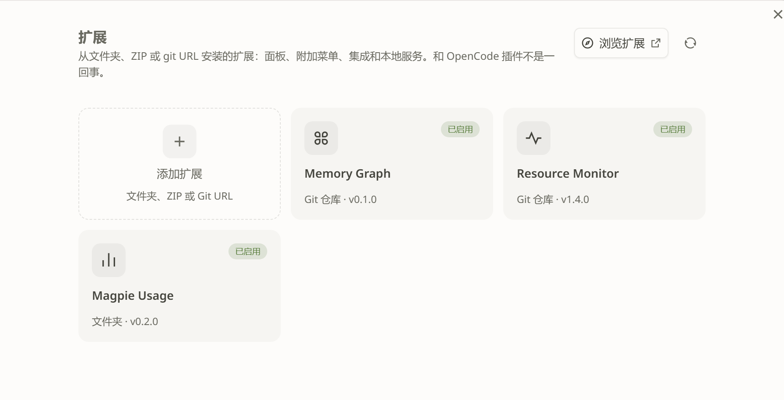

<p><sub>OpenChamber **Settings → Extensions**. The installed extension is listed as **Magpie Usage**. The screenshot is cropped to the settings dialog; no project or session content is included. Magpie desktop has no extension-installer screen, so this group is OpenChamber-only.</sub></p>

For local development, paste the absolute path to your checkout in the same dialog instead of the Git URL. OpenChamber does not compile TypeScript: `panel/main.js` and `service/main.js` are built artifacts and must exist on disk. Bun 1.4 or newer is only needed to build them.

`package.json` declares `engines.openchamber` `>=2.5.0` and pins `@openchamber/sdk` `2.5.1`.

## What the panel shows

All numbers come from the local service. The footer states the scope: this is usage recorded by the local gateway for requests sent to this endpoint, not the endpoint's total usage. It does not include requests other clients send directly to the endpoint.

### Usage

The `today` / `7d` / `30d` switch changes the upstream period.

- **TOKEN**: input + output. Cache reads are reported separately.
- **Cache hit**: `cache_read / (input + cache_read + cache_write)`. The row shows `—` when the denominator is 0; it never shows `0%` or `NaN`.
- **Calls**: includes failures, retries, and looped calls.
- **Cost (est.)** and the number of unpriced calls.
- **Credits** and the number of calls that reported them.
- The `since` timestamp supplied by the gateway.

<table>
<tr>
<td width="50%">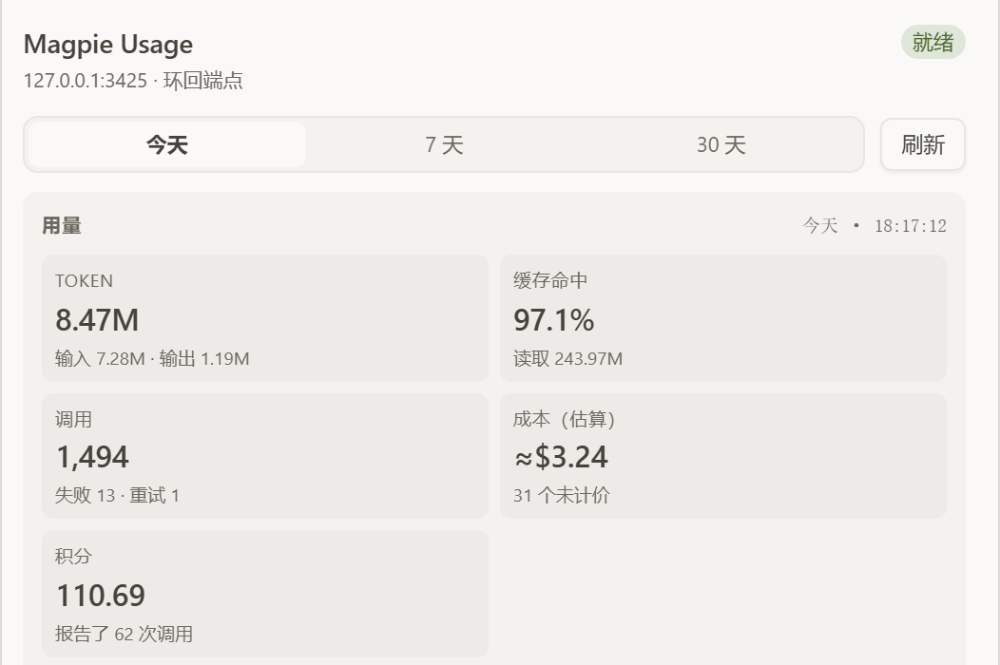</td>
<td width="50%">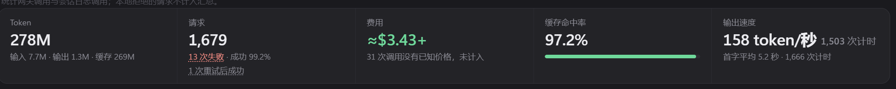</td>
</tr>
<tr>
<td><sub><b>OpenChamber</b>, Today.</sub></td>
<td><sub><b>magpie desktop</b>, Today. Its Token KPI includes cache reads, so it is larger; the panel keeps cache reads in a separate KPI.</sub></td>
</tr>
</table>

<table>
<tr>
<td width="50%">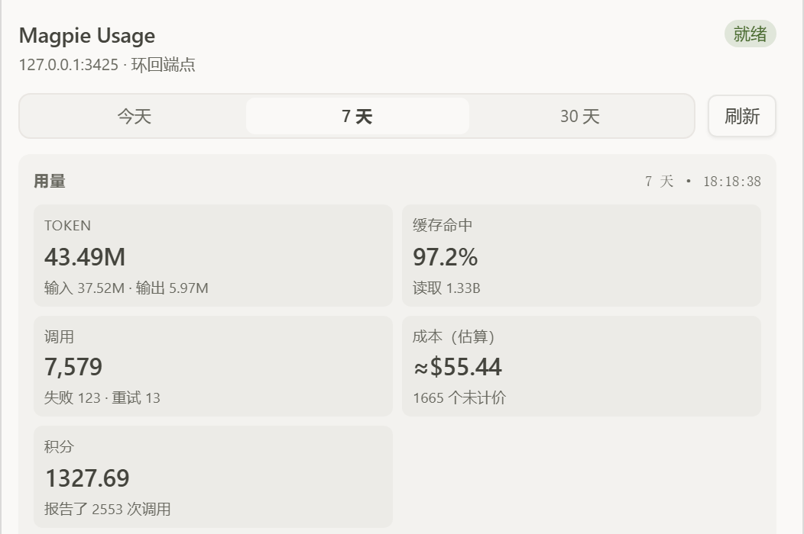</td>
<td width="50%"></td>
</tr>
<tr>
<td><sub><b>OpenChamber</b>, 7 days.</sub></td>
<td><sub><b>magpie desktop</b>, 7 days. The two reads are not simultaneous; the aggregation rules are not identical.</sub></td>
</tr>
</table>

<table>
<tr>
<td width="50%">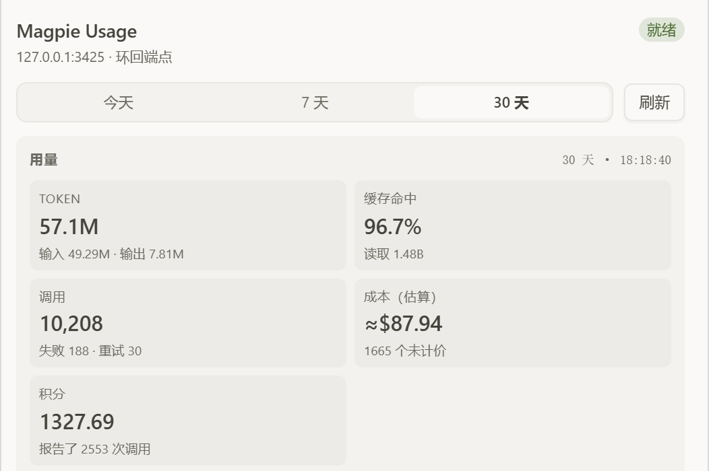</td>
<td width="50%">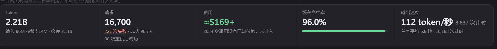</td>
</tr>
<tr>
<td><sub><b>OpenChamber</b>, 30 days.</sub></td>
<td><sub><b>magpie desktop</b>, 30 days.</sub></td>
</tr>
</table>

### Trend

The panel draws one bar per upstream `series` bucket. Each bar is split into input (including cache) and output. Each bar has a label cell beneath it. The chart shows a fixed number of labels: seven for the 30-day period (`MM-DD`, from each bucket's date) and six for the 24-hour period (`HH`, the hour). The first label is aligned to the first bar's left edge, the last to the last bar's right edge, and the rest are centred under their bars. Labels are horizontal and do not depend on `fontScale`. Wrapping of labels that would crowd each other is not implemented yet, so at a large `fontScale` the gap between two labels can shrink below two characters.

<table>
<tr>
<td width="50%">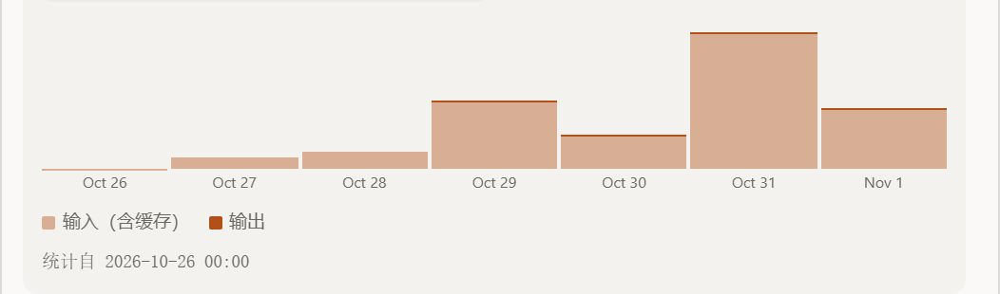</td>
<td width="50%">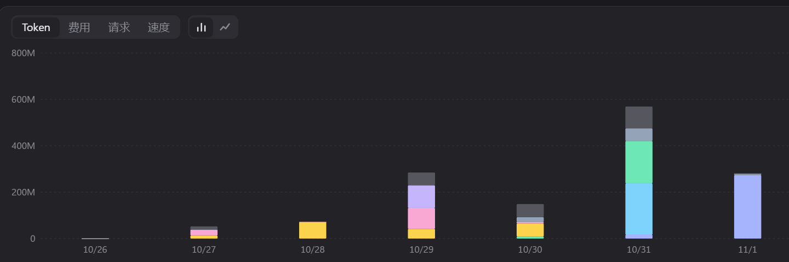</td>
</tr>
<tr>
<td><sub><b>OpenChamber</b>, 7-day trend. Input includes cache.</sub></td>
<td><sub><b>magpie desktop</b>, 7-day usage chart. Magpie stacks by model and adds a 53-week heat map; the panel keeps the two-series bucket view.</sub></td>
</tr>
</table>

### Quota cards

Quota cards follow Magpie's own quota page. Each card has a header row:

- The provider mark is the drag handle.
- Card name, plan label, and the tightest remaining percentage.
- Click the header or the chevron to expand or collapse. The first two cards are expanded by default; expansion state is remembered for the session.
- **Error cards stay fully visible and cannot be collapsed.**

Windows are grouped by the upstream `pool` field. One pool is one row with a two-column grid. A pool with fewer than two windows is left-aligned; a third window wraps. When the card is narrower than 260px, a container query switches to one column.

Each window cell shows:

- Window name and `N% left`.
- A 4px bar filled to the remaining amount; at 0.5% or less it uses the warning colour.
- `remaining / limit unit`, computed as `limit − amount`. When there is no number to subtract, the upstream `display` is shown unchanged.
- `resets …`, `runs out …`, and `pool …`.

Within a pool, layered model names ending in `(High)`, `(Low)`, or `(Medium)` are not rendered separately. If a pool has no duration window at all, the most-used layer is kept so the pool cannot disappear.

<table>
<tr>
<td width="50%">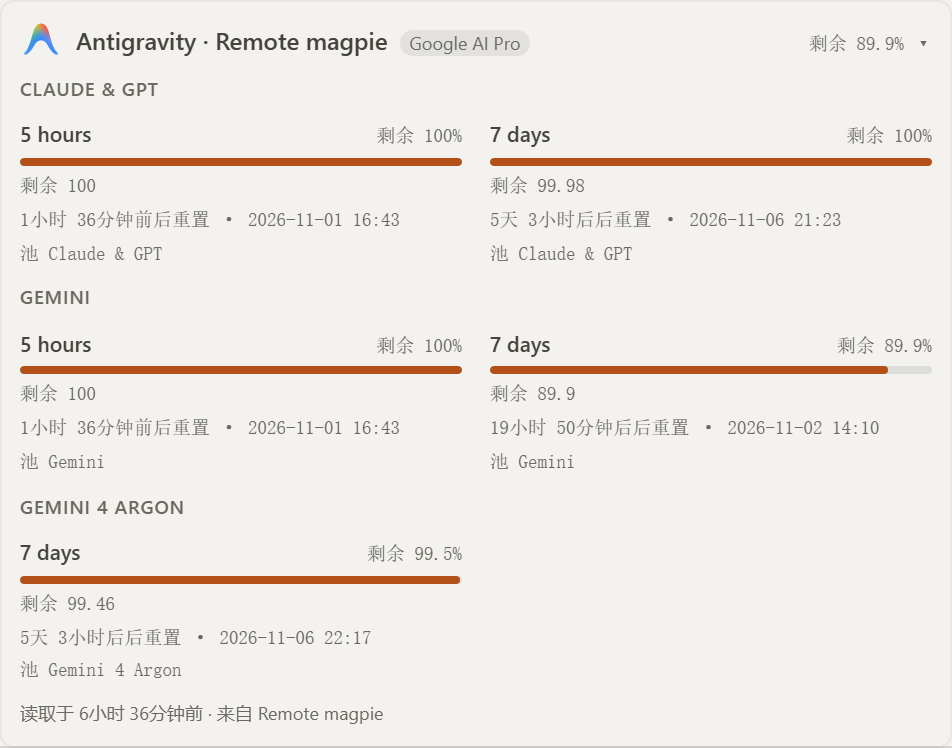</td>
<td width="50%">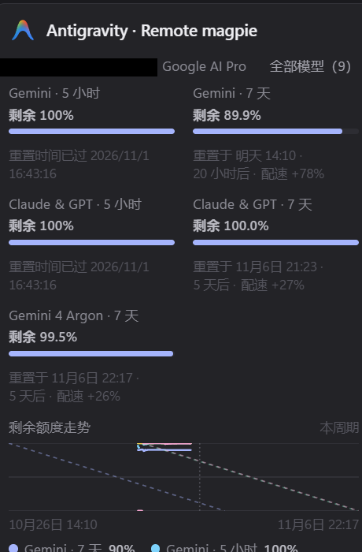</td>
</tr>
<tr>
<td><sub><b>OpenChamber</b>: three pool rows, nine <code>(High)/(Low)/(Medium)</code> layers folded away. Every duration window and every pool label remains.</sub></td>
<td><sub><b>magpie desktop</b>: the same account with every layer visible. The account email is irreversibly covered with a solid black bar.</sub></td>
</tr>
</table>

<table>
<tr>
<td width="50%">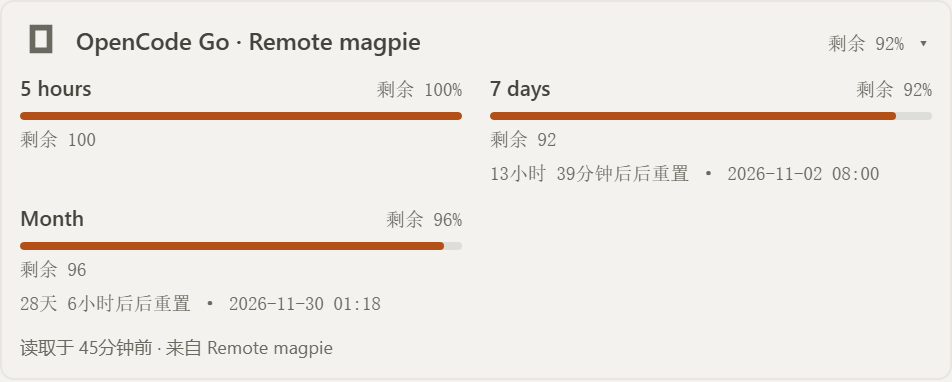</td>
<td width="50%">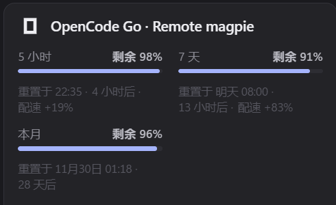</td>
</tr>
<tr>
<td><sub><b>OpenChamber</b>: the same three windows, two columns, remaining first.</sub></td>
<td><sub><b>magpie desktop</b>: same provider and windows. Magpie adds a remaining-credit trend; the panel omits it to keep the card compact.</sub></td>
</tr>
</table>

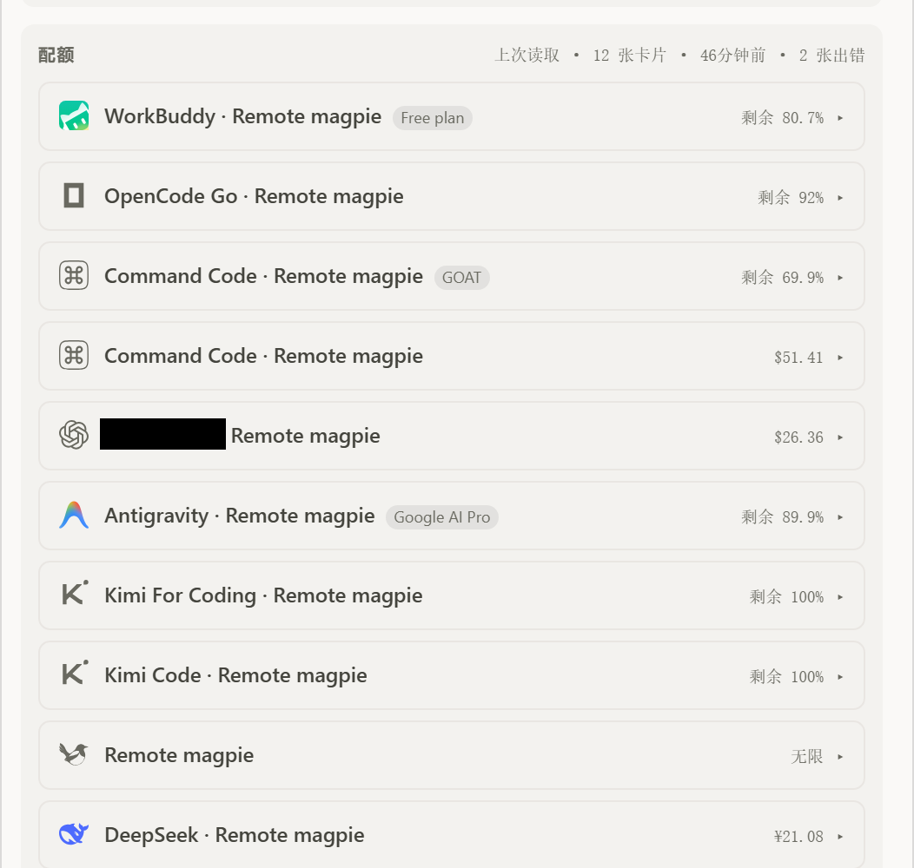

<p><sub>All cards collapsed. The provider marks stay visible as drag handles; the chevron expands a card. One provider name is redacted. Error cards are not in this crop because they never collapse.</sub></p>

### Balance cards

Balance cards split the upstream ` · `-joined string into label/value rows: the label is the text before the last space. A single-segment string is shown whole. Missing numbers render as `—`; no row shows `NaN`.

<table>
<tr>
<td width="50%">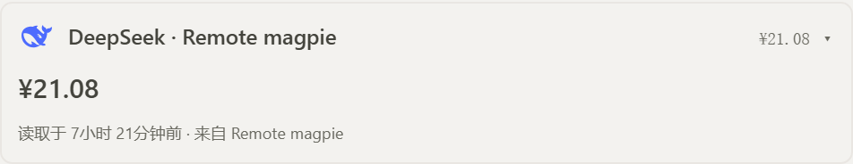</td>
<td width="50%">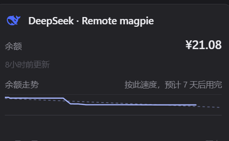</td>
</tr>
<tr>
<td><sub><b>OpenChamber</b>: a single-segment balance, shown whole as <code>¥21.08</code>.</sub></td>
<td><sub><b>magpie desktop</b>: the same provider and balance, with its remaining-credit trend.</sub></td>
</tr>
</table>

<table>
<tr>
<td width="50%">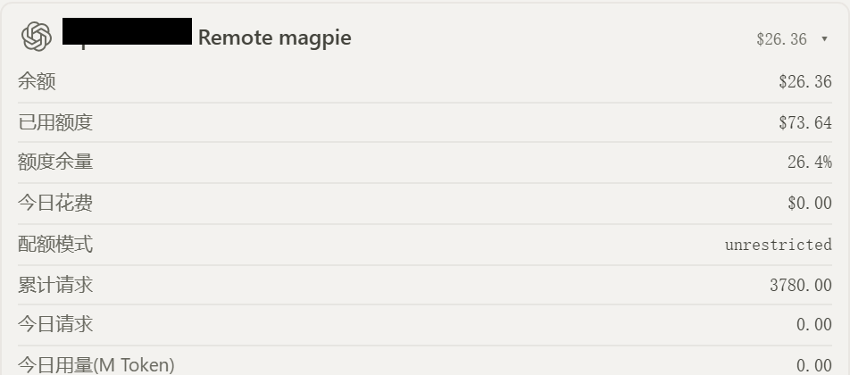</td>
<td width="50%">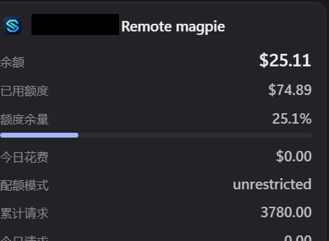</td>
</tr>
<tr>
<td><sub><b>OpenChamber</b>: a custom OpenAI-compatible endpoint; the provider name is redacted. The upstream string becomes separate label/value rows. This read is $26.36.</sub></td>
<td><sub><b>magpie desktop</b>: the same endpoint at $25.11, also with the provider name redacted. The reads are not simultaneous; this pair compares the layout, not the cents.</sub></td>
</tr>
</table>

### Ordering

Drag a card by its provider mark, or focus the mark and press <kbd>↑</kbd>, <kbd>↓</kbd>, <kbd>Home</kbd>, or <kbd>End</kbd>. The order is written to `cardOrder` in `config.json`. If the write fails, the panel keeps the new order, shows `order not saved` next to the Quotas heading, and retries on the next drop. Keyboard moves are announced through `aria-live`. Magpie desktop has no equivalent card-ordering control; this group is OpenChamber-only.

<table>
<tr>
<td width="50%">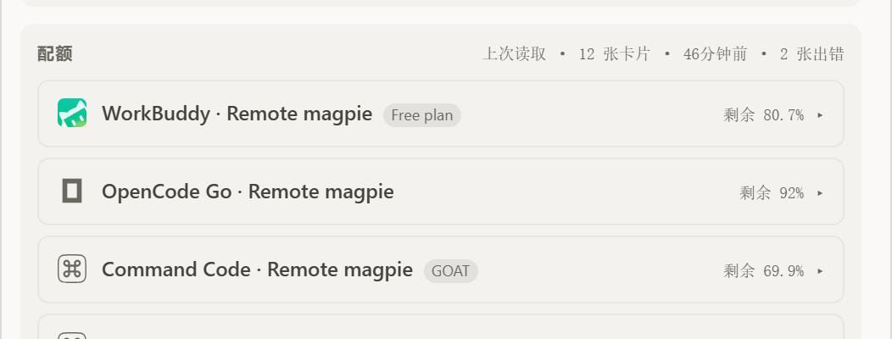</td>
<td width="50%">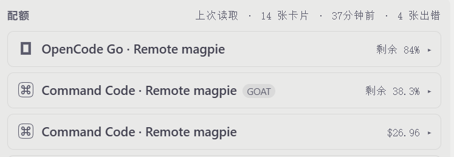</td>
</tr>
<tr>
<td><sub><b>Before</b>: WorkBuddy is first. Every provider mark is a visible drag handle.</sub></td>
<td><sub><b>After</b>: WorkBuddy moved to third with the keyboard. The static frames show the handles and the resulting order; a drag in progress is not required.</sub></td>
</tr>
</table>

### Error cards

An upstream failure becomes an error card with the service's error category, status, and endpoint. The upstream response body is never passed through to the panel.

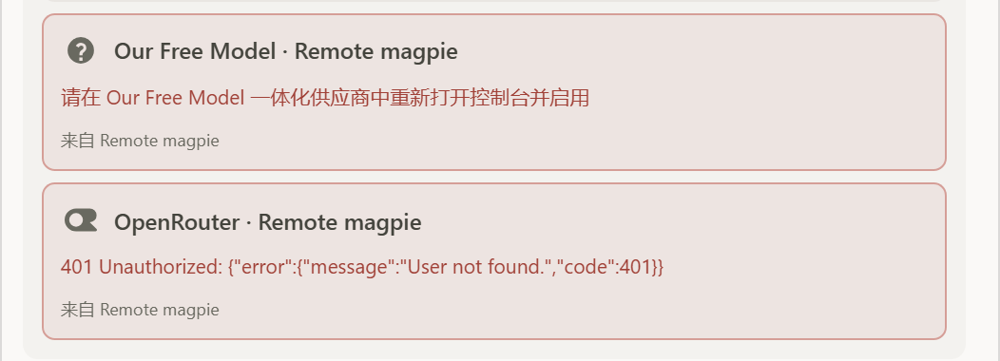

<p><sub><code>Our Free Model</code> and <code>OpenRouter</code> fail independently; the other 10 cards still render. magpie desktop has no transport-error card for this case — its nearest state is “quota unavailable”, which is a different contract — so this group is OpenChamber-only.</sub></p>

### Typography

The panel uses the host font stack: `--oc-font` and `--oc-mono` come from OpenChamber's theme, so the panel renders with whatever fonts the host renders with. The extension ships no font files, no `@font-face` rules, and no font licence text or font provenance manifest.

Every type size in the panel is in rem. `fontScale` in `config.json` sets the root font-size to `14px × fontScale / 100`, so 100 renders the 14px base; the type was authored at 12px, so 100% is also 14/12 of the old sizes (about +16.7%). `fontScale` is the panel's manual equivalent of OpenChamber's interface font-size setting: the host does not pass that percentage to guest frames — SDK 2.5.1's `HostReadyContext` carries font, mono, and radius only, and `applyHostReady` writes `0.875rem` on the guest root — so the Configuration card shows the active percentage and a note telling the user to set `fontScale` to the same percentage as OpenChamber. An invalid `fontScale` falls back to 100 and produces a visible issue; the endpoint and the API key are not degraded. Chart labels do not depend on the scale; their count is fixed (see [Trend](#trend)).

### Configuration and language

The Configuration card shows the config file path, the effective endpoint, whether an API key is configured, the refresh interval, the active `fontScale` percentage, configuration issues, and the backup path after a broken file was replaced.

<table>
<tr>
<td width="50%">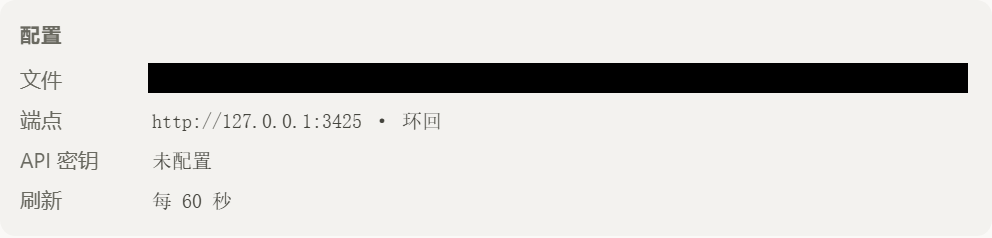</td>
<td width="50%">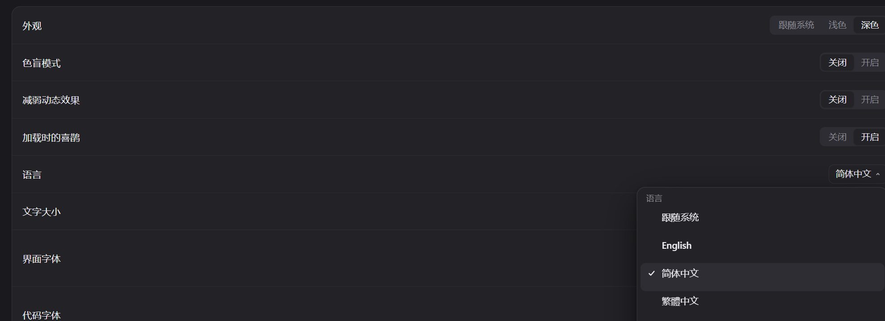</td>
</tr>
<tr>
<td><sub><b>OpenChamber</b>: the absolute path is irreversibly blacked out. Language is not a panel control; it is read from <code>config.json</code>.</sub></td>
<td><sub><b>magpie desktop</b>: its own language control. The extension and Magpie read the same idea but keep separate settings.</sub></td>
</tr>
</table>

The panel has English and Simplified Chinese copy; those are the only runtime locales. Set `language` to `en` or `zh-CN` in `config.json`; `auto` follows the host locale and resolves only an exact `zh-CN` match to Chinese. `panel/locales/ar.json` stays in the repository as a `"test": true` fixture for key, plural, and direction checks, but it is no longer imported into the runtime bundle: a host locale of `ar`, or an explicit `language: "ar"`, resolves to English with `dir=ltr`. Text renders with the host font stack (`--oc-font` / `--oc-mono`), so whatever the host font supports is what appears in dynamic data — provider names, quota window names. The next refresh re-reads `/config`, so the change applies without restarting the service or OpenChamber.

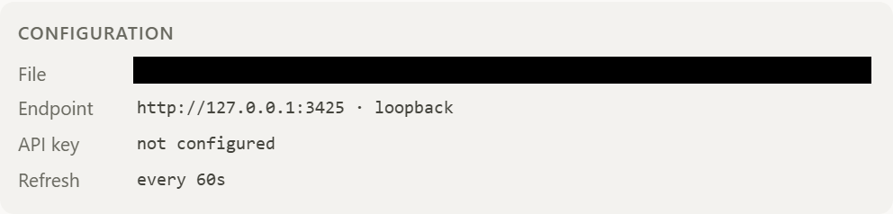

<p><sub>After <code>language: "en"</code>, the same card renders in English. The path is redacted. Unknown or non-string values fall back to <code>auto</code> with a notice; they do not disable the endpoint or the key.</sub></p>

## Configuration

The only configuration source is:

```text
$XDG_CONFIG_HOME/openchamber-magpie-usage/config.json
```

Without `XDG_CONFIG_HOME`, use `~/.config/openchamber-magpie-usage/config.json`. Windows uses the same layout: `%USERPROFILE%\.config\openchamber-magpie-usage\config.json`.

```json
{
  "baseUrl": "http://127.0.0.1:3425",
  "apiKey": "optional; usually required for a non-loopback endpoint",
  "refreshSeconds": 60,
  "fontScale": 100,
  "cardOrder": ["r-magpie%2Fworkbuddy|subscription|example-user"],
  "language": "auto"
}
```

| Field | Required | Rule |
| --- | --- | --- |
| `baseUrl` | No | Absolute http(s) URL. No credentials, query string, or fragment. A non-loopback host must use https. A path prefix is allowed. |
| `apiKey` | No | Non-empty string without whitespace or control characters. Sent only as `Authorization: Bearer`; never placed in the URL. |
| `refreshSeconds` | No | Integer 5–3600. Default 60. |
| `fontScale` | No | Integer 50–200. Default 100, which renders the 14px base; the root font-size is `14px × fontScale / 100` and every panel type size is in rem. A non-integer or out-of-range value falls back to 100 and sets `fontScaleInvalid`; the endpoint and the key still apply. |
| `cardOrder` | No | String array, at most 500 entries, each 1–200 characters. Parsed leniently: a non-array value, a non-string entry, an over-long entry, or too many entries drops only the bad part; the rest of the config still applies. Order is presentation only and never degrades the endpoint. |
| `language` | No | `auto` (default), `en`, or `zh-CN`. Case-sensitive; must equal a non-test `code` in `panel/locales/index.json` (entries marked `test`, such as `ar`, are not runtime languages). A non-string or empty value falls back to `auto` with a notice; the endpoint and key still apply. |

Behaviour:

- Missing file: fall back to `http://127.0.0.1:3425` with no key.
- Present but unusable file (bad JSON, out-of-range field, http URL pointing at a remote host, and so on): the same default endpoint, with the reason shown in Configuration. The panel does not go blank.
- The service reads the file on every request. Saving applies immediately; no service or app restart is needed.
- `apiKey` may be absent or `null`; both mean "not configured". Any other non-string value is invalid.
- `apiKey` is allowed to be an empty string? No: an empty string is not a valid key.
- `cardOrder` keys are `encodeURIComponent(provider)|encodeURIComponent(kind)|encodeURIComponent(user)`. A second or third card with the same triple gets `#2` or `#3`. Keys the gateway no longer reports are ignored; new cards are appended in gateway order.
- `fontScale` is the panel's manual equivalent of OpenChamber's interface font-size setting; the host does not pass that percentage to guest frames. `GET /config` reports `fontScale` and `fontScaleInvalid`, and `POST /config/order` preserves `fontScale`.
- Writes use two-space indentation and a trailing newline, preserve unknown top-level keys, keep the original file mode (0600 when it cannot be read), write a temporary file, then `rename` over the original.
- If the file is not a valid JSON object when an order is written, the original is copied to `config.json.bak` (or `config.json.bak-<UTC timestamp>` if that exists), a file containing only `cardOrder` is written, and Configuration keeps a notice. A missing file is created, which removes the "No config file yet" note.

The key only enters the service process. The panel receives the boolean `apiKeyConfigured`; it has no key input, never echoes the key, and never writes it to storage, logs, URLs, or the build output.

## Service API

The service binds only to `127.0.0.1:<port assigned by the host>`. Every request must carry `Authorization: Bearer $OPENCHAMBER_SERVICE_TOKEN`. Only `GET` is accepted, plus `POST /config/order`; every other method/path combination returns 405 or 404.

| Route | Purpose |
| --- | --- |
| `GET /health` | The original contract `{ ok, name, apiVersion }`, unchanged. |
| `GET /config` | Config path, effective endpoint, `apiKeyConfigured`, refresh interval, `fontScale`, `fontScaleInvalid`, `cardOrder`, `reset` (`{ at, backupPath }` after a broken config was replaced, otherwise `null`), `language`, `languageInvalid`, and configuration issues. |
| `POST /config/order` | Body `{ "order": string[] }`; 200 `{ ok: true, order, reset }`. Body limit 64 KiB; 1–500 strings of 1–200 characters; anything else is 400 `bad-request`. |
| `GET /v1/magpie/usage?period=today\|7d\|30d` | Normalised usage summary. |
| `GET /v1/magpie/quotas?kept=1` | Prefer the upstream cached read. |
| `GET /v1/magpie/quotas?refresh=1` | Ask for a fresh read; repeated requests inside 30 seconds are throttled. |

Order-write details:

- All writes in one process are serialised through one promise chain, so two panels cannot interleave read-modify-write.
- The merge replaces only `cardOrder`; `fontScale`, `language`, `refreshSeconds`, and the other top-level keys are preserved.
- Read → merge `cardOrder` → write `<path>.<pid>.<rand>.tmp` → `chmod` the temporary file to the original mode (0600 when unreadable) → `rename` over the original.
- If the file is not a valid JSON object: back up the original (`.bak`, or `.bak-<UTC timestamp>` if it exists), write `{ "cardOrder": [...] }`, and keep `{ at, backupPath }` in memory for `/config`. A service restart clears the notice.
- A missing file is created; `present` becomes true and the "No config file yet" note disappears.

Refresh policy:

- Automatic cycle: usage takes the summary; quotas request upstream `?kept=1` first.
- Manual refresh: quotas request a fresh read without `kept`, throttled to one read per 30 seconds. A click inside the window returns the previous read and marks it `throttled`.
- Measured on this machine: Magpie `0.1.2470` returns an empty `data` array for `GET /v1/magpie/quotas?kept=1` while a normal request returns 12 cards. When `kept=1` returns zero cards, the service falls back to the last successful read and marks it `stale`; with no previous read it performs one normal read. Without this fallback, every automatic refresh would empty the card list.

Error mapping (HTTP 502/504, one category per cause, never conflated with a network error):

```text
upstream-unauthorized (401)
upstream-forbidden (403)
upstream-status (other status)
upstream-timeout (504)
upstream-network (connection failed)
upstream-not-json
upstream-schema (shape mismatch)
upstream-redirect (cross-origin redirect rejected)
```

Redirect policy: `redirect: "manual"`. Same-origin redirects are followed up to three times; any cross-origin redirect is rejected and the key is never sent to another origin.

The upstream error body is not returned to the panel. Only the category, status, and endpoint are returned, so an upstream cannot leak a key or internal detail through its response body.

## Boundaries and security

- The panel runs in a sandboxed iframe and loads a classic IIFE `panel/main.js`. It cannot `fetch`, use XHR, read or write browser storage, or dial the local service directly. Order saves also go through `host.serviceRequest`; the panel makes no network request of its own.
- Panel colours come only from the host's `--oc-*` variables. The stylesheet contains no hard-coded light or dark values.
- Host controls (badge, refresh button) are mounted once at module load. A repeated `onReady` snapshot only updates values.
- The local service runs with the current user's privileges, binds only to `127.0.0.1`, and checks the Bearer token on every request. The token is never logged.
- Keys belong only to the service process. They must not appear in the panel, the bundles, logs, URLs, or a commit.

## Development

Bun 1.4 or newer.

```bash
bun install
bun run check      # typecheck -> tests -> build
bun run build      # build panel/main.js and service/main.js only
bun test           # all tests
bun test tests/quotas.test.ts
bun run typecheck
```

OpenChamber does not compile TypeScript. `panel/main.js` and `service/main.js` are committed build artifacts. The entry chain is `src/panel/main.ts` (`connectHost()` and mount) → `src/panel/app.ts` (`mountPanel`) → `panel/main.js`; the service entry is `src/service/main.ts` → `service/main.js`. Static panel assets are not built: `panel/index.html` links `panel/styles.css`. There are no font assets: the stylesheet has no `@font-face` rules and requests no fonts of its own.

Runtime locale files are imported by `src/panel/app.ts` and inlined into `panel/main.js` at build time, because the panel cannot `fetch`; only `en` and `zh-CN` are imported — `panel/locales/ar.json` is a `"test": true` fixture that stays out of the bundle. Adding a language therefore changes JSON, the imports, and the `MESSAGES` map, then requires a rebuild.

CI runs `bun install --frozen-lockfile`, `bun run check`, and `git diff --exit-code -- panel/main.js service/main.js`. A source change without a rebuilt bundle fails CI. See [CONTRIBUTING.md](CONTRIBUTING.md) for the full workflow, screenshots, and translation rules.

### Test coverage

`bun test` runs 225 tests in 12 files, all offline: fake gateway, temporary config directory, and real HTTP round-trips between the test client and the built service. Panel tests use a fake host and happy-dom; they start no HTTP server, connect to no real host, and do not touch the user's config directory.

| File | Coverage |
| --- | --- |
| `tests/config.test.ts` | Config validation: JSON shape, http/https rules, loopback detection, credentials and query strings, key characters, refresh range, unknown keys; lenient `cardOrder`; order-key encoding; `#2` suffixes; known/unknown/expired keys; `language` defaults, explicit values, invalid fallback without endpoint degradation; `fontScale` default, 50–200 range, and invalid fallback without endpoint degradation. |
| `tests/i18n.test.ts` | Registry validity, key parity, placeholder parity, CLDR plural categories (`one/other` in English, `other` in `zh-CN`), interpolation/fallback, exact `resolveLocale` matching and unsupported markers; the Arabic `test` fixture is RTL but never a runtime match. |
| `tests/format.test.ts` | Number, cost, credit, percentage, and time formatting; zero hit-rate denominator; window-percentage fallback chain; money-row priority. |
| `tests/quotas-view.test.ts` | Pool grouping and layered folding (Antigravity's three rows, nine hidden layers), duration sorting, pool-less windows sharing a row, remaining-amount rows, balance splitting, tightest remaining, icon mapping and fallback. |
| `tests/service.test.ts` | Bearer check, `/health` contract, three `/config` paths (including `fontScale`/`fontScaleInvalid` in the report), immediate config reload, 405/404 method/path combinations; `POST /config/order` write, unknown-key and mode preservation, creation when missing, invalid-file backup + reset + report, bad and oversized bodies, concurrent writes, 401. |
| `tests/usage.test.ts` | Period and key forwarding, default/invalid periods, missing fields without NaN, 401/403/500/timeout/connection failure/non-JSON/schema mismatch. |
| `tests/quotas.test.ts` | All card variants, `kept`/`refresh` forwarding, throttling, empty-cache fallback, cross-origin redirect rejection, same-origin redirect following. |
| `tests/secret.test.ts` | The key never appears in `/config`, logs, or build artifacts; no key literal in source. |
| `tests/panel-bundle.test.ts` | The panel is a classic IIFE, has no fetch/XHR, uses no storage, uses only `--oc-*`, mounts controls once outside `onReady`, inlines icons as data URIs, and contains the two-column grid and container query. |
| `tests/panel-host.test.ts` | Mounts the panel with a fake host: first-screen `/config`, usage, and `kept=1` requests; KPI and quota cards; `HostRequestError` codes and the service error vocabulary; non-JSON and shape errors without echoing upstream text; period switching only re-fetches usage; manual refresh sends `refresh=1`; throttled/stale copy; keyboard order writes `/config/order`; `order not saved`; expand/collapse; repeated `onReady` does not remount; four `serviceStatus` badges; `language` and host-locale selection, fallback, and `languageInvalid`; Arabic fallback to English with `dir=ltr`; root font-size after repeated ready; the invalid `fontScale` notice; chart labels: the `MM-DD` and `HH` text, fixed counts, and independence from `fontScale`. |
| `tests/health.test.ts` | The shared `/health` contract used by the panel and the service. |
| `tests/manifest.test.ts` | Manifest paths, required build artifacts, and package metadata. |
| `tests/harness.ts`, `tests/fixtures.ts` | Fake gateway and captured payload fixtures; support files, not test suites. |

## Verification

Verified on 2026-11-01. This record predates `fontScale` and the language-fallback change; the suite now has 225 passing tests in 12 files, and `bun run check` remains the gate. The hashes and sizes below refer to that build:

- `bun run check` passed: typecheck, 211 tests in 12 files (0 fail, 1,783 expectations), and both builds.
- Two consecutive builds were byte-identical. SHA-256:
  - `panel/main.js`: `EC65B475AE7FAFBD90C639B64EBB2FBCD22C7EA1B9CD1C6DFAF2FD9EEFB4DA81` (110,454 bytes)
  - `service/main.js`: `A0535553EF5DE80055BC668721EB1AE9A8C47697E3B403CCFCABF6E8E50C6E95` (28,078 bytes)
- `git diff --exit-code -- panel/main.js service/main.js` exited 0 after the check.
- Screenshots: 24 images across all 8 groups, in `docs/images/`. OpenChamber and magpie desktop are side by side for usage (today/7d/30d), the 7-day trend, pooled quota cards, balance cards, and configuration/language. Account e-mails, the API-key fragment, and the absolute config path were removed with solid fills or excluded from the crop.
- Real gateway: 12 cards rendered with no script errors. Antigravity folded into three pool rows (Claude & GPT, Gemini, Gemini 4 Argon) with all nine `(High)/(Low)/(Medium)` layers hidden; windows sorted 5 hours → 7 days.
- The custom OpenAI-compatible endpoint's balance string split into 14 label/value rows; the single-segment `¥21.08` stayed whole; `unlimited`, the four balance cards, and the two error cards rendered correctly; no money row showed `NaN`.
- Container query: at about 340px card width, `grid-template-columns` was `154px 154px`; at 240px it became a single `220px` column.
- Dragging the first card to third position wrote `cardOrder` while preserving `baseUrl`; reopening the panel kept the order. Keyboard `End` moved a card and `aria-live` announced "moved to position 12 of 12".
- Writing invalid JSON into `config.json` and then dragging a card copied the original byte-for-byte to `config.json.bak` and rewrote a valid file containing only `cardOrder` (two-space indent, trailing newline). Configuration reported `config.json was invalid; saved as … and reset`.
- A forced write failure (config path occupied by a directory) kept the new order, showed `order not saved` next to Quotas, and included the service's reason.

Not verified:

- The screenshots in `docs/images/` were captured before `fontScale` (at the old 12px design size) and before 0.3.1; they should be re-captured once 0.3.1 is installed.
- The Electron right-sidebar chrome and the permission-approval dialog: the screenshots use the real installed extension in OpenChamber's UI, but the host window chrome is cropped away.
- The full `--oc-*` theme matrix: the captured panel is in the light theme; the dark host theme was not exhaustively compared.
- Other Magpie versions' window names and `pool` fields: the folding rule only recognises `(High|Low|Medium)` and only applies inside a pool.
- The semantics of upstream `kept=1` on other Magpie versions; on this machine it returns an empty list.

### Right-to-left layout

`panel/locales/ar.json` is a fixture, not a language anyone is offered: the registry marks it `"test": true`, and it is no longer imported into the runtime panel bundle. Runtime locales are `en` and `zh-CN` only. The fixture still participates in key, plural, and direction checks: key parity, the six Arabic CLDR plural categories, and the same placeholders as English.

A host locale of `ar`, or an explicit `"language": "ar"` in the config file, resolves to English with `dir=ltr`; an explicit value outside the runtime registry also raises the `config.language.unsupported` notice. Text renders with the host font stack (`--oc-font` / `--oc-mono`), so whatever the host font supports is what appears in dynamic data (provider names, quota window names). The old panel-level Arabic RTL test was replaced by fallback tests.

`panel/styles.css` still drops the letter-spacing the Latin labels use under `[dir='rtl']`, because tracking breaks Arabic joins, but no runtime locale resolves to `dir="rtl"` today.

Not covered: the Arabic copy was written for layout testing and is not native-proofread, and the mirrored layout is not reachable through configuration while only `en` and `zh-CN` run.

## License

MIT. See [LICENSE](LICENSE).

Provider marks (WorkBuddy, Antigravity, DeepSeek, Kimi, Command Code, opencode, OpenRouter, OpenAI, magpie) come from [yetone/magpie](https://github.com/yetone/magpie) under `internal/gui/assets/icons/`, also MIT; most originate from lobe-icons. The marks remain the property of their owners and are used only to label the provider of a quota card. The `generic` fallback is drawn by this project.
