# openchamber-magpie-usage

[English](README.md) | **简体中文**

OpenChamber 右侧栏扩展，用于查看 [Magpie](https://usemagpie.ai) 的用量汇总、趋势，以及网关返回的全部额度卡与余额卡。

面板不自行获取应用数据。它只调用 `host.serviceRequest()`；扩展自带的本地服务向配置的 Magpie 端点发起只读 GET，把结果规范化后交回面板。浏览器为面板发起的唯一外部加载，是经批准的 jsDelivr 界面字体文件（见[排版与字体](#排版与字体)）。

## 目录

- [安装](#安装)
- [面板显示什么](#面板显示什么)
- [配置](#配置)
- [服务接口](#服务接口)
- [边界与安全](#边界与安全)
- [贡献](#贡献)
- [许可](#许可)

## 安装

1. 在 OpenChamber 中打开 **Settings → Extensions**。
2. 在 *Folder, ZIP, or URL* 中填入仓库地址，然后选择 **Add**：

   ```text
   https://github.com/lilixxs/openchamber-magpie-usage.git
   ```

3. 批准 **Run a local service**。
4. 点击右侧栏的柱状图图标打开面板。

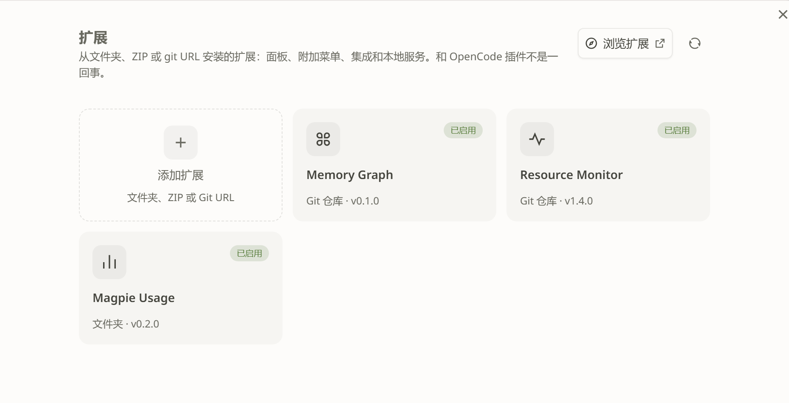

<p><sub>OpenChamber 的 **Settings → Extensions**。已安装扩展显示为 **Magpie Usage**。截图裁到设置对话框，不含项目或会话内容。magpie 桌面端没有扩展安装界面，因此本组只截 OpenChamber。</sub></p>

本地安装同理：在同一个对话框里选择本仓库目录，而不是 Git URL。OpenChamber 不编译 TypeScript，磁盘上必须有已提交的 `panel/main.js` 与 `service/main.js`；构建、测试与发布流程见 [CONTRIBUTING.zh-CN.md](CONTRIBUTING.zh-CN.md)。

`package.json` 声明 `engines.openchamber` 为 `>=2.5.0`，并把 `@openchamber/sdk` 固定在 `2.5.1`。

## 面板显示什么

所有数字都来自本地服务。页脚写明了口径：这是本机网关记录的、发往该端点的用量，不是该端点的全部用量，也不包含其他客户端直连该端点产生的请求。

### 用量

`today` / `7d` / `30d` 切换上游统计周期。

- **TOKEN**：输入 + 输出。缓存读取单独显示。
- **缓存命中**：`cache_read / (input + cache_read + cache_write)`。分母为 0 时显示 `—`，不会显示 `0%` 或 `NaN`。
- **调用**：包含失败、重试与循环调用。
- **成本（估算）** 与未计价调用数。
- **积分** 与报告了积分的调用数。
- 上游给出的 `since` 统计起点。

<table>
<tr>
<td width="50%">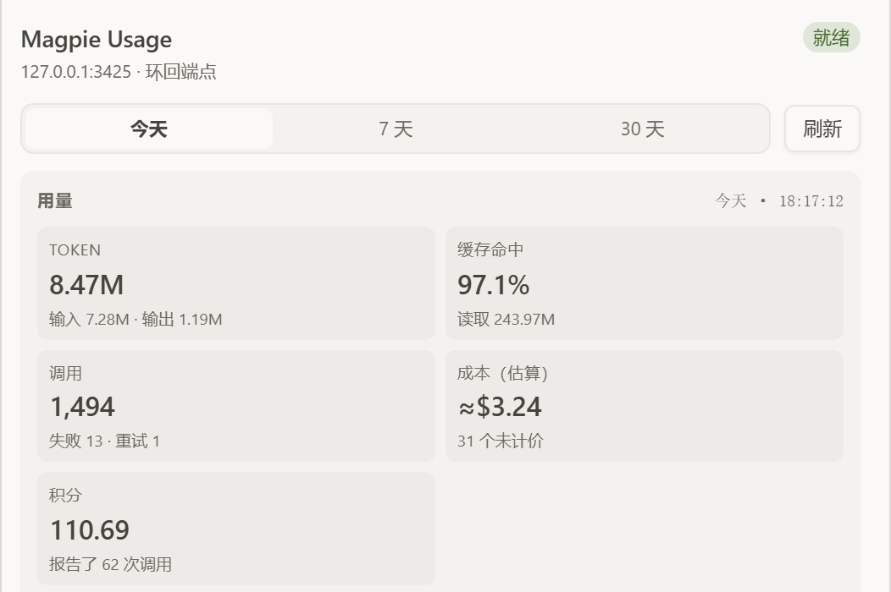</td>
<td width="50%">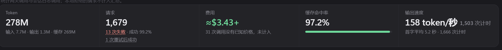</td>
</tr>
<tr>
<td><sub><b>OpenChamber</b>，今天。</sub></td>
<td><sub><b>magpie 桌面端</b>，今天。它的 Token 口径包含缓存读取，所以数值更大；面板把缓存读取放在单独的 KPI 里。</sub></td>
</tr>
</table>

<table>
<tr>
<td width="50%">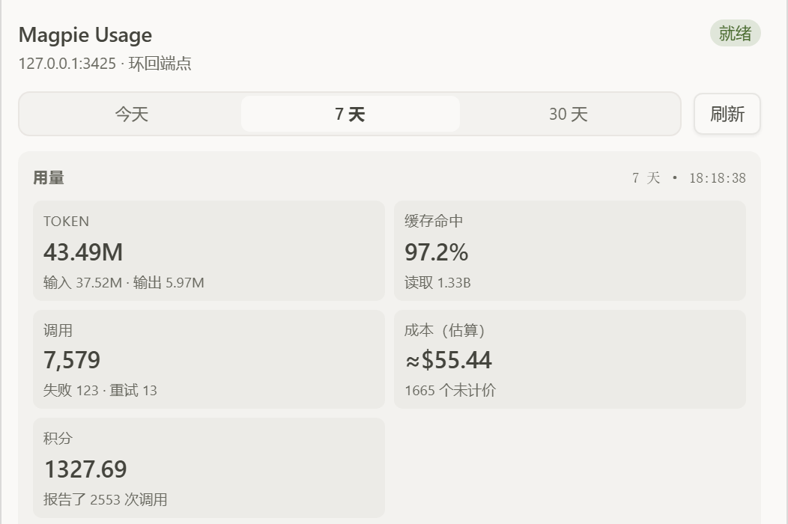</td>
<td width="50%"></td>
</tr>
<tr>
<td><sub><b>OpenChamber</b>，7 天。</sub></td>
<td><sub><b>magpie 桌面端</b>，7 天。两次读取不是同一时刻，聚合口径也不完全相同。</sub></td>
</tr>
</table>

<table>
<tr>
<td width="50%">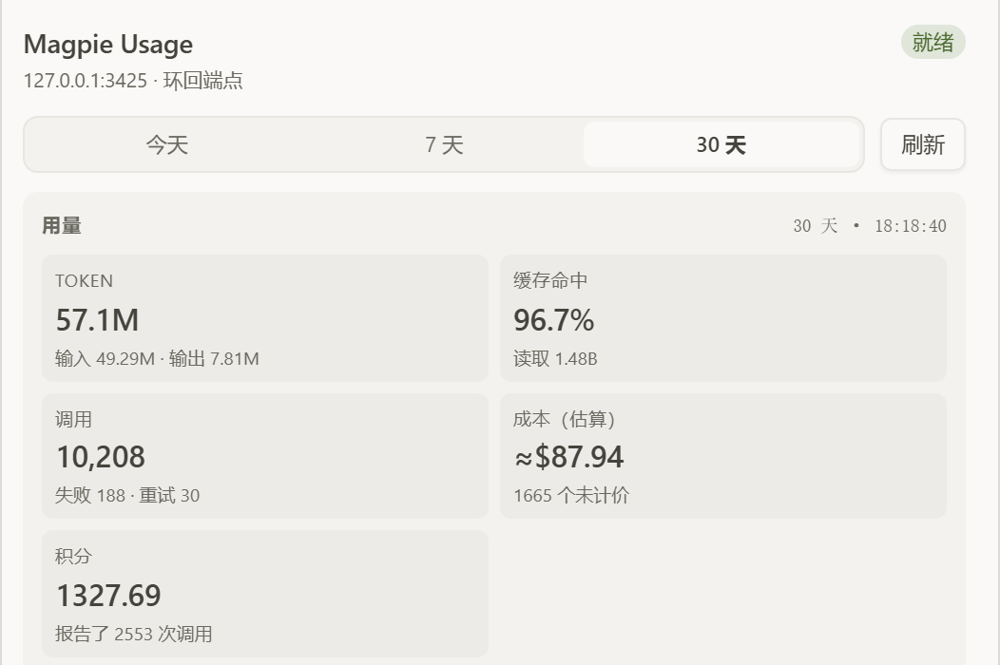</td>
<td width="50%">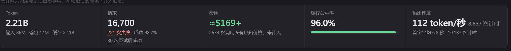</td>
</tr>
<tr>
<td><sub><b>OpenChamber</b>，30 天。</sub></td>
<td><sub><b>magpie 桌面端</b>，30 天。</sub></td>
</tr>
</table>

### 趋势

面板按上游 `series` 的每个桶画一根柱。每根柱分为输入（含缓存）与输出。每根柱下方有一个标签格。图表显示固定数量的标签：30 天 7 个，格式 `MM-DD`（取自每个桶的日期）；24 小时 6 个，格式 `HH`（小时）。第一个标签与第一根柱左对齐，最后一个与最后一根柱右对齐，其余居中于对应柱下。标签横排、不旋转，且与 `fontScale` 无关。标签之间的换行（间距不足时跨行）尚未实现，`fontScale` 变大时标签间距可能小于 2 个字符。

<table>
<tr>
<td width="50%">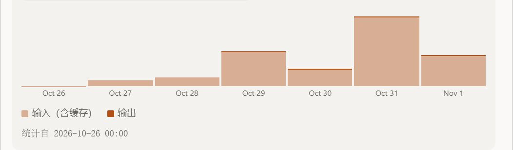</td>
<td width="50%">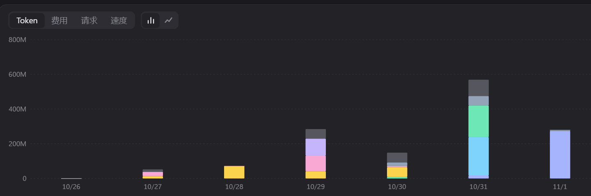</td>
</tr>
<tr>
<td><sub><b>OpenChamber</b>，7 天趋势。输入包含缓存。</sub></td>
<td><sub><b>magpie 桌面端</b>，7 天用量图。Magpie 按模型堆叠，并附带热力图；面板保留较精简的两段桶视图。</sub></td>
</tr>
</table>

### 额度卡

额度卡对齐 Magpie 自己的额度页。每张卡的头部包含：

- 厂商标识（同时是拖拽手柄）。
- 卡名、套餐标签、该卡最紧的剩余百分比。
- 点击头部或箭头展开/收起。默认展开前 2 张；展开状态在当前会话内记忆。
- **错误卡始终完整可见，不能折叠。**

厂商标识按四步解析：`config.jsonc` 的 `providerIcons` 覆盖 → 从 magpie 图标生成的映射 → 与 id 同名的打包文件（`id`、`id-color`、`id.png`；PNG 标识不带扩展名也可命中）→ `generic`。只有已打包的图标名能生效，写错的名称会静默落到下一步。本机自定义渠道（例如自建的 OpenAI 兼容端点）不保证自动命中，需要特定标识时在 `providerIcons` 里自行配置。

窗口按上游 `pool` 分组。一个 pool 一行，行内两列网格。不足两个窗口的 pool 靠左，第三个窗口自动换行。卡片宽度小于 260px 时，容器查询切换为单列。

每个窗口格显示：

- 窗口名与 `N% left`。
- 填到「剩余」的 4px 进度条；剩余 ≤0.5% 时使用 warning 色。
- `剩余 / 上限 单位`，由 `limit − amount` 算出；没有可减的数时原样显示上游 `display`。
- `resets …`、`runs out …` 与 `pool …`。

同一个 pool 内，名字尾段为 `(High)`、`(Low)`、`(Medium)` 的分层模型不单独渲染。若某个 pool 完全没有时长窗口，则保留其中用得最多的一层，避免该 pool 消失。

下面的额度卡截图用 OpenCode Go 与 Command Code，它们没有 `pool`；pool 分组与分层折叠由 `tests/quotas-view.test.ts` 与 [CONTRIBUTING.zh-CN.md](CONTRIBUTING.zh-CN.md#验证) 里的真实网关检查覆盖。

<table>
<tr>
<td width="50%">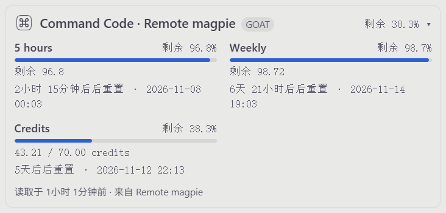</td>
<td width="50%">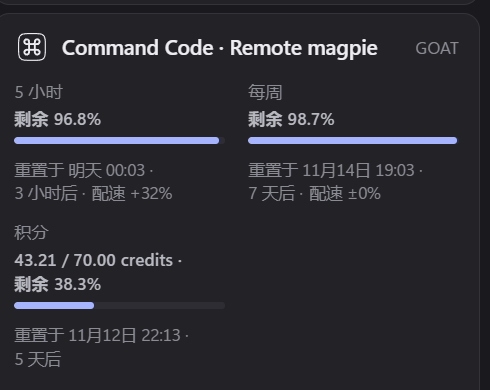</td>
</tr>
<tr>
<td><sub><b>OpenChamber</b>：三个窗口，没有 pool。5 小时与 Weekly 占第一行，积分换行到第二行。积分行没有 <code>limit − amount</code> 可算，因此原样显示上游 <code>display</code>。</sub></td>
<td><sub><b>magpie 桌面端</b>：同一供应商、同样的窗口。Magpie 的剩余额度走势在图下方，不在本裁图内；面板为紧凑省略了它。</sub></td>
</tr>
</table>

<table>
<tr>
<td width="50%">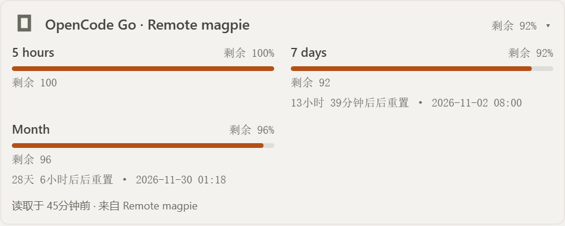</td>
<td width="50%"></td>
</tr>
<tr>
<td><sub><b>OpenChamber</b>：OpenCode Go 的三个窗口，两列，剩余优先。</sub></td>
<td><sub><b>magpie 桌面端</b>：同一供应商、同样的窗口。Magpie 多一条剩余额度走势；面板为紧凑省略了它。</sub></td>
</tr>
</table>

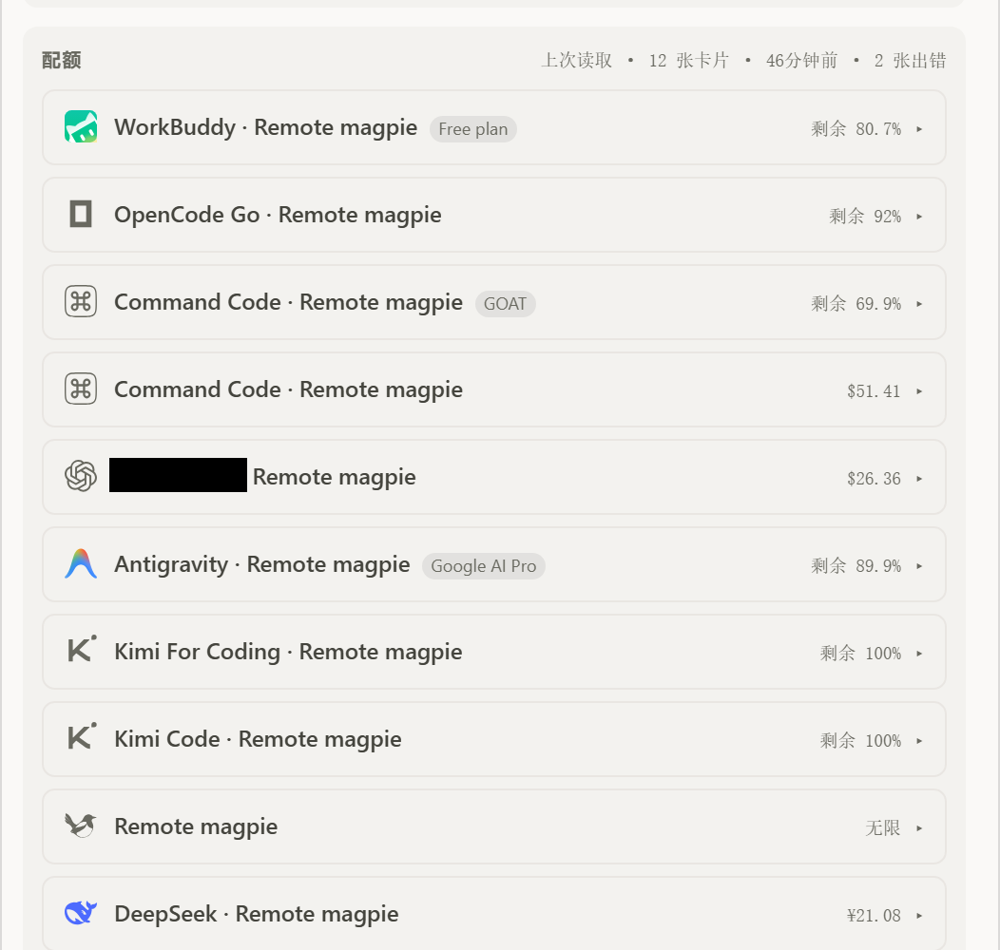

<p><sub>七张卡片折叠。厂商标识仍作为拖拽手柄显示；点箭头可重新展开。这张裁图里没有遮盖任何供应商名称。错误卡不在这张裁图里，因为它们从不折叠。</sub></p>

### 余额卡

余额卡把上游用 ` · ` 连接的字符串拆成「标签 / 数值」行：标签是最后一个空格前的文字。单段字符串整体显示。缺失的数字显示为 `—`，不会出现 `NaN`。

<table>
<tr>
<td width="50%">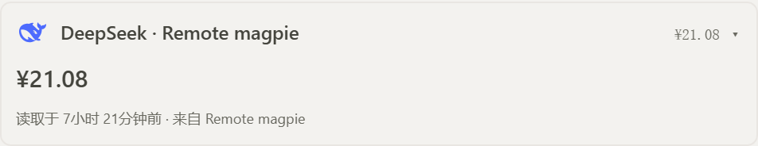</td>
<td width="50%">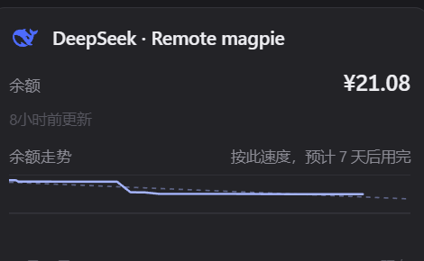</td>
</tr>
<tr>
<td><sub><b>OpenChamber</b>：单段余额，整体显示为 <code>¥21.08</code>。</sub></td>
<td><sub><b>magpie 桌面端</b>：同一供应商、同一余额，附带剩余额度走势。</sub></td>
</tr>
</table>

<table>
<tr>
<td width="50%">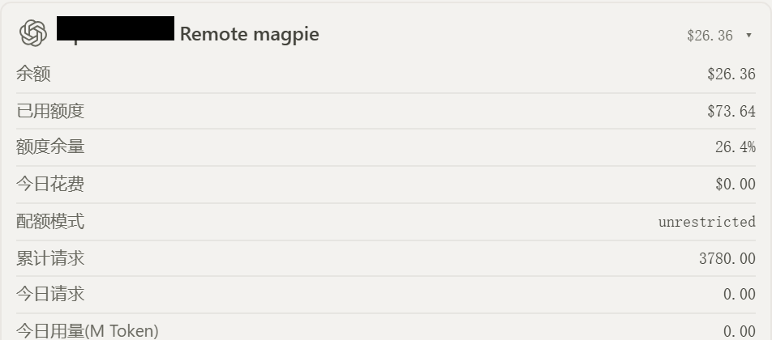</td>
<td width="50%">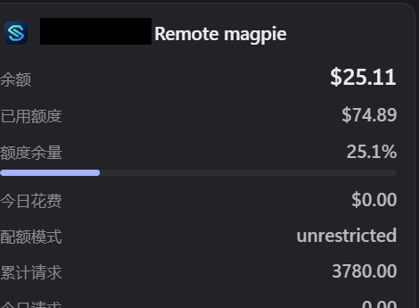</td>
</tr>
<tr>
<td><sub><b>OpenChamber</b>：自定义 OpenAI 兼容端点；供应商名称已遮盖。上游字符串拆成独立的标签/数值行。本次读取为 $26.36。</sub></td>
<td><sub><b>magpie 桌面端</b>：同一端点，数值为 $25.11，供应商名称同样已遮盖。两次读取不是同一时刻；这一对比较的是布局，不是分币级数值。</sub></td>
</tr>
</table>

### 排序

拖动厂商标识，或聚焦标识后按 <kbd>↑</kbd>、<kbd>↓</kbd>、<kbd>Home</kbd>、<kbd>End</kbd>。顺序写入 `config.jsonc` 的 `cardOrder`。写盘失败时，面板保留新顺序，在「配额」标题旁显示 `order not saved`，下次放下时重试。键盘移动通过 `aria-live` 播报。magpie 桌面端没有等价的卡片排序控件；这一组只截 OpenChamber。

<table>
<tr>
<td width="50%">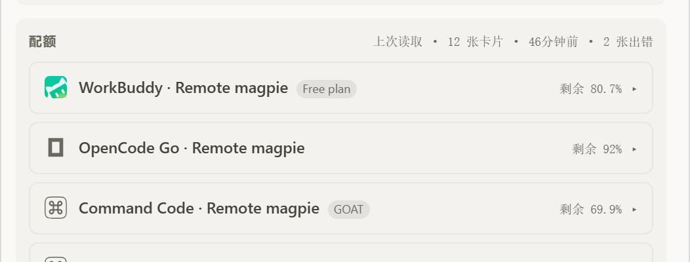</td>
<td width="50%">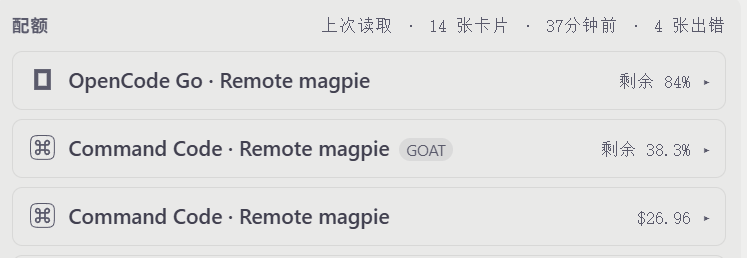</td>
</tr>
<tr>
<td><sub><b>排序前</b>：Command Code 第一。每张卡的厂商标识都是可见的拖拽手柄。</sub></td>
<td><sub><b>排序后</b>：用键盘把 OpenCode Go 移到第一。静态图展示手柄与最终顺序，不需要捕捉拖拽瞬间。</sub></td>
</tr>
</table>

### 错误卡

上游失败会生成错误卡，显示服务给出的错误类别、状态码与端点。上游响应体不会透传给面板。

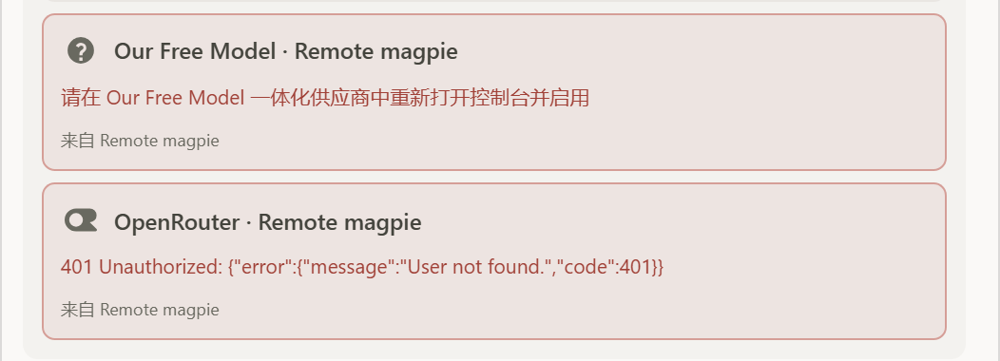

<p><sub><code>Our Free Model</code> 与 <code>OpenRouter</code> 各自失败，其余 10 张卡照常渲染。magpie 桌面端没有对应这种传输错误的卡片——它最接近的状态是额度页的「暂时无法获取额度」，那是另一套契约——因此这一组只截 OpenChamber。</sub></p>

### 排版与字体

面板使用宿主的字体栈：`--oc-font` 与 `--oc-mono` 来自 OpenChamber 的主题。OpenChamber 把界面字体从 jsDelivr 载入宿主文档；guest 帧有自己的 `FontFaceSet`，只靠字体栈会落到本地回退字体。当字体栈首项是 OpenChamber 自带的字族（Inter、Noto Sans、Fira Code 等）时，`src/panel/fonts.ts` 声明同样的 `@font-face` 规则，从 jsDelivr 载入 Latin WOFF2。包在 `contributes.origins` 中声明 `https://cdn.jsdelivr.net`，安装或更新对话框会请求用户批准。自定义或系统字族不声明字体面，直接用本地回退。扩展不携带字体文件、字体许可全文或字体来源清单。

面板里所有字号都用 rem。`config.jsonc` 的 `fontScale` 把根字号设为 `14px × fontScale / 100`，因此 100 对应 14px 基准；字号按 12px 设计稿编写，所以 100% 同时是旧尺寸的 14/12（约 +16.7%）。`fontScale` 是面板对 OpenChamber 界面字号设置的手动等价物：宿主不会把该百分比传给 guest 帧——SDK 2.5.1 的 `HostReadyContext` 只带 font、mono 与 radius，`applyHostReady` 给 guest 根写 `0.875rem`——所以配置卡会显示当前百分比，并提示把 `fontScale` 设成与 OpenChamber 相同的百分比。`fontScale` 非法时回退到 100 并产生可见提示；端点与 API 密钥不受影响。图表标签不随字号变化，数量固定（见[趋势](#趋势)）。

### 配置与语言

配置卡是页脚前的最后一张卡。它不属于额度列表：没有拖拽手柄，不参与 `cardOrder` 排序，位置永远不变。默认收起；展开状态只记在当前面板实例的内存里——刷新、切换语言、重复 `onReady` 都不会丢，面板重新挂载时复位。卡头是单色齿轮、**配置** 二字、当前文件状态和一个箭头。它是一个真正的按钮，带 `aria-expanded` 与 `aria-controls`，隐藏的卡体无法用键盘访问。状态依次为 **正在检查…**、**未创建**、**有效**、**无效**、**无法读取**，只描述配置文件本身；网关连通性由 `serviceStatus` 徽章表示，不由这里反映。

卡体显示完整的实际文件路径（自动换行，不做省略号），它是一个可聚焦的按钮，通过 `host.writeClipboard` 复制路径并给出成功或失败反馈；复制不会切换卡片的展开状态。卡体还显示生效端点、是否已配置 API 密钥、刷新间隔、当前 `fontScale` 百分比、配置问题，以及文件被重建后哪些字段被恢复、哪些回退到默认值。这里没有「编辑配置」按钮，没有关联到系统文件管理器，没有宿主文件预览，也不做本地/远端探测：面板只告诉你文件在哪、处于什么状态。文件缺失时，卡体改为提供带确认/取消步骤的「创建配置文件」按钮。

<table>
<tr>
<td width="50%">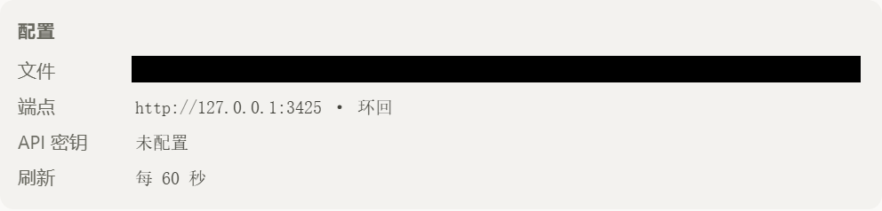</td>
<td width="50%">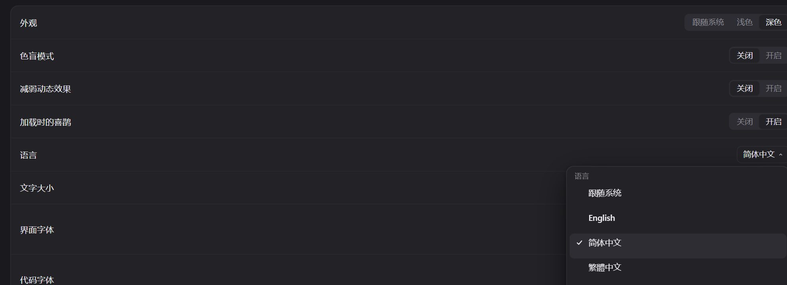</td>
</tr>
<tr>
<td><sub><b>OpenChamber</b>：绝对路径用不可逆黑条遮盖。语言不是面板控件，而是从 <code>config.jsonc</code> 读取。</sub></td>
<td><sub><b>magpie 桌面端</b>：它自己的语言控件。扩展与 Magpie 采用同一思路，但各自保存设置。</sub></td>
</tr>
</table>

面板提供英文与简体中文，运行时只有这两种语言。把 `config.jsonc` 的 `language` 设为 `en` 或 `zh-CN`；`auto` 跟随宿主语言，只有精确命中 `zh-CN` 才显示中文。`panel/locales/ar.json` 以 `"test": true` 夹具的形式留在仓库里，用于键、复数与方向检查，但不再打进运行时产物：宿主语言为 `ar`，或显式写 `language: "ar"`，都会解析为英文、`dir=ltr`。文字用宿主字体栈（`--oc-font` / `--oc-mono`）渲染；面板为自带字族载入宿主的 Latin 网页字体，其他文字回退到系统字体，与宿主一致。下一轮刷新会重读 `/config`，不用重启服务或 OpenChamber。

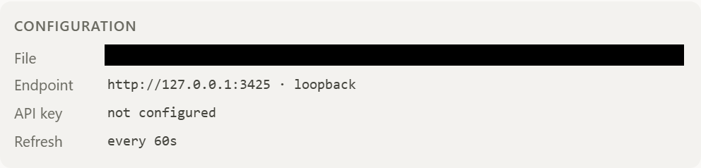

<p><sub>设置 <code>language: "en"</code> 后，同一张卡显示英文。路径已遮盖。未知值或非字符串会回退 <code>auto</code> 并提示，不会禁用端点或密钥。</sub></p>

## 配置

> **从 `config.json` 升级？** 扩展现在只读 `config.jsonc`。旧文件从不被读取、复制、改名或迁移，所以在你手动搬过去之前，旧的端点和 API 密钥不再生效。请在第一次打开新面板之前完成迁移：见 [docs/config-migration.md](docs/config-migration.md)。

唯一的配置来源：

```text
$XDG_CONFIG_HOME/openchamber-magpie-usage/config.jsonc
```

没有 `XDG_CONFIG_HOME` 时用 `~/.config/openchamber-magpie-usage/config.jsonc`。Windows 使用同一布局：`%USERPROFILE%\.config\openchamber-magpie-usage\config.jsonc`。

文件是 JSONC：允许 `//` 行注释与 `/* */` 块注释，不允许尾随逗号，重复的顶层键会被拒绝，所有语法错误都会被报告而不是被容忍。允许单个前导 UTF-8 BOM，并在编辑 `cardOrder` 时保留它；第二个前导 BOM 或出现在其他位置的 BOM 仍按语法错误处理。未知的顶层键解析时被忽略，在 `cardOrder` 编辑时逐字节保留。旧的 `config.json` 从不被读取：两个文件同时存在时只用 `config.jsonc`。

```jsonc
{
  // 允许注释；不允许尾随逗号。
  "baseUrl": "http://127.0.0.1:3425",
  "apiKey": null,
  "refreshSeconds": 60,
  "fontScale": 100,
  "cardOrder": [],
  "language": "auto",
  // 扩展新建的文件只有 "~keys"；下面的 "openai-mm": "openai"
  // 是自定义覆盖示例，不是默认值。
  "providerIcons": { "~keys": "magpie", "openai-mm": "openai" }
}
```

由扩展创建的文件在每个字段上方带有固定的双语注释；模板里的示例密钥与示例顺序只是注释，永远不会成为生效值。原本就是严格 JSON 的内容在这里照常有效，也不会被重排格式。平台支持时，新文件以 `0600` 权限创建。

| 字段 | 必填 | 规则 |
| --- | --- | --- |
| `baseUrl` | 否 | 绝对 http(s) URL。不得带账号密码、查询串或片段。非环回主机必须用 https。允许带路径前缀。 |
| `apiKey` | 否 | 非空字符串，不含空白与控制字符。只以 `Authorization: Bearer` 发送，绝不放进 URL。 |
| `refreshSeconds` | 否 | 整数 5–3600，默认 60。 |
| `fontScale` | 否 | 整数 50–200，默认 100，对应 14px 基准；根字号为 `14px × fontScale / 100`，面板所有字号均为 rem。非整数或越界时回退 100 并置 `fontScaleInvalid`；端点与密钥照常生效。 |
| `cardOrder` | 否 | 字符串数组，最多 500 项，每项 1–200 字符。宽松解析：值不是数组、含非字符串项、项超长或超量时只丢坏的部分，其余配置照常生效。顺序只影响外观，绝不会让端点降级。 |
| `language` | 否 | `auto`（默认）、`en` 或 `zh-CN`。大小写敏感，必须等于 `panel/locales/index.json` 中非 `test` 的 `code`（标了 `test` 的条目如 `ar` 不是运行时语言）。非字符串或空串回退 `auto` 并提示；端点与密钥照常生效。 |
| `providerIcons` | 否 | 宽松对象：键是 provider 名最后一个 `/` 之后的部分，值是已打包的图标名。最多 200 项，键与值各不超过 80 字符，任意 own 字符串键都按普通映射保留。值不是对象时整体丢弃，坏项静默丢弃，未知图标名静默忽略；不产生新的 `invalid`，不改变配置卡卡头。扩展新建的文件默认带 `{ "~keys": "magpie" }`；已有文件不会被自动加上该字段，需要时自行添加——缺该字段的文件生效值为空映射。重建时，旧 `providerIcons` 映射能从原文证明完整就原样保留，只有无法恢复时才回退 `{ "~keys": "magpie" }`。 |

行为：

- 文件不存在：生效配置是 `http://127.0.0.1:3425` 且无密钥，`present` 为 false、`validity` 为 `missing`。配置卡显示 **未创建**，并给出带确认/取消步骤的「创建配置文件」按钮；见下文「首次打开与存储」。
- 文件存在但不可用（语法错误、重复顶层键、根不是对象、字段越界、http 指向远端等）：同样回退到默认端点，并在配置卡显示原因。面板不会因此空白。文件读不到、权限不足或路径不是普通文件时报告为 `unreadable`，绝不当作缺失，也绝不会被覆盖。
- 服务每个请求都重读文件。保存即生效，不用重启服务或应用。
- `apiKey` 可以缺失或为 `null`，两者都表示「未配置」。其他非字符串值不合法，空字符串也不是合法密钥。
- `cardOrder` 的键为 `encodeURIComponent(provider)|encodeURIComponent(kind)|encodeURIComponent(user)`。同一三元组的第二、第三张卡追加 `#2`、`#3`。网关已不存在的键会被忽略；新增卡片按网关顺序排在末尾。
- `fontScale` 是面板对 OpenChamber 界面字号设置的手动等价物；宿主不会把该百分比传给 guest 帧。`GET /config` 回传 `fontScale` 与 `fontScaleInvalid`，`POST /config/order` 保留 `fontScale`。
- `providerIcons` 只是图标覆盖映射：坏值不产生新的 `invalid`，不改变配置卡卡头；`GET /config` 回传该映射，任何字段都不携带由密钥推导的内容。厂商标识的四步解析见[额度卡](#额度卡)。
- 写入只替换根级 `cardOrder`，用 `jsonc-parser` 就地编辑。其他字段、未知顶层键、该数组之外的注释、缩进与 CRLF/LF 换行都逐字节保留；`cardOrder` 数组内部的注释可能丢失，生成的模板对此有说明。保存在服务进程内通过一条 promise 链串行，两个面板不会交错读-改-写。文件保留原权限（读不到时 0600），先写 `<path>.<pid>.<rand>.tmp`，再 `rename` 发布。
- 发布前服务会重读文件：磁盘内容变了就返回 409 `config-conflict`，不覆盖任何数据。新建文件是排他创建（硬链接，失败时回退到排他 `wx` 打开），期间出现的文件绝不会被替换。与其他进程的写入竞态无法被绝对排除，见 [CONTRIBUTING.zh-CN.md](CONTRIBUTING.zh-CN.md#验证)。
- 结构损坏的文件（语法错误、重复顶层键、根不是对象）只在保存顺序时原地重建：完整模板 + 提交的顺序，然后把旧原文逐行追加为 `//` 注释，并带双语标记。不会生成 `.bak` 或其他备份文件，旧版本留下的备份也不会被删除。字段值错误**不会**触发重建——只编辑 `cardOrder`，坏值留在文件里由用户自己修。服务把 `{ at, restored, defaulted, previousText: 'appended-comments' }` 记在内存里、只在服务存活期内有效；重启后提示消失，文件里的注释保留。回报中绝不含旧原文、密钥、密钥长度或密钥前缀。
- 文件缺失时保存顺序会直接创建文件，于是 `present` 变为 `true`，面板的「No config file yet」随之消失。

首次打开与存储：

- 面板不写 `localStorage`、`sessionStorage`、IndexedDB 或 cookie。唯一的例外是一个带版本前缀、按实例作用域存放的宿主存储标记 `openchamber-magpie-usage:v1:config-initialized`，它只记录文件是否已初始化——绝不记录配置内容、路径、密钥、顺序或任何折叠状态。
- 安装后的首次打开：文件确实缺失且标记不存在时，面板调用一次 `POST /config/create`，写入完整的双语模板。文件已存在时只写标记，绝不覆盖已有文件。
- 标记读不到或写不进去时，面板既不自动创建，也不把现状当作首次安装。配置卡上的手动按钮照常可用，已存在的文件也绝不会被回滚。
- 标记存在而文件后来被删除时，面板不会重建文件；配置卡显示创建按钮。
- 文件缺失时重排卡片仍会按当前顺序创建完整模板——这是「只创建一次」的明确例外。

密钥只进入服务进程。面板只拿到布尔值 `apiKeyConfigured`；没有密钥输入框，不回显，不写入任何存储、日志、URL 或构建产物。

## 服务接口

服务只监听 `127.0.0.1:<host 分配的端口>`。每个请求都必须带 `Authorization: Bearer $OPENCHAMBER_SERVICE_TOKEN`。只接受 `GET`，以及写入用的 `POST /config/create` 与 `POST /config/order`；其余方法/路径组合一律 405（带 `Allow: GET, POST`）或 404。请求体上限 64 KiB。

| 路径 | 作用 |
| --- | --- |
| `GET /health` | 原有契约 `{ ok, name, apiVersion }`，未改动。 |
| `GET /config` | 完整文件状态：`configPath`、`baseUrl`、`host`、`loopback`、`apiKeyConfigured`、`refreshSeconds`、`fontScale`、`fontScaleInvalid`、`cardOrder`、`cardOrderInvalid`、`language`、`languageInvalid`、`providerIcons`、`recovery`（重建后为 `{ at, restored, defaulted, previousText: 'appended-comments' }`，否则 `null`）、`source`（`file` 或 `default`）、`present`、`validity`（`missing` / `valid` / `invalid` / `unreadable`）、`issue`（文档级或致命问题，否则 `null`）与 `issues`（`{ field, kind, message }` 数组）。任何字段都不可能承载密钥。 |
| `POST /config/create` | 体 `{}` 或 `{ "order"?: string[] }`；200 `{ ok: true, created, present: true }`。幂等：文件已存在则原样保留且 `created` 为 `false`。`order` 为 0–500 个字符串、每个 1–200 字符；其余一律 400 `bad-request`。 |
| `POST /config/order` | 体 `{ "order": string[] }`；200 `{ ok: true, order, recovery }`。1–500 个字符串、每个 1–200 字符；其余一律 400 `bad-request`。字段值错误不触发重建，结构损坏才重建。 |
| `GET /v1/magpie/usage?period=today\|7d\|30d` | 规范化后的用量汇总。 |
| `GET /v1/magpie/quotas?kept=1` | 优先读上游缓存。 |
| `GET /v1/magpie/quotas?refresh=1` | 请求新读数；30 秒内重复请求被节流。 |

配置写入的细节：

- 同一进程内所有写入串成一条 promise 链，两个面板不会交错读-改-写。失败的写入不会阻塞队列。
- 合并只替换根级 `cardOrder`，用 `jsonc-parser` 就地编辑；`fontScale`、`language`、`refreshSeconds`、`providerIcons`、未知键与该数组之外的注释都逐字节保留。
- 读文件 → 编辑 → 写 `<path>.<pid>.<rand>.tmp` → 按原文件权限 `chmod` 临时文件（读不到时 0600）→ 再读一次原文件，内容已变则以 409 `config-conflict` 中止 → `rename` 覆盖。
- 新建是排他的：硬链接（失败时回退到排他 `wx` 打开）绝不会覆盖期间出现的文件。`POST /config/create` 或顺序保存创建的文件，平台支持时权限为 0600。
- 结构损坏的文件原地重建：完整模板 + 提交的顺序，再把旧原文逐行追加为 `//` 注释并带双语标记。不写 `.bak`，也不删除旧备份。服务把 `{ at, restored, defaulted, previousText: 'appended-comments' }` 记在内存里供 `/config` 回报；重启后提示清空，文件注释保留。
- 字段值错误不重建：只编辑 `cardOrder`，非法值留在文件里。读不到、权限不足或非普通文件的写入一律失败，绝不报成功。
- 文件缺失时直接新建；`present` 变为 `true`，面板的「No config file yet」随之消失。

刷新策略：

- 周期自动刷新：用量直接取汇总；额度先请求上游 `?kept=1`。
- 手动刷新：额度请求上游不带 `kept` 的新读数，并以 30 秒窗口节流；窗口内的重复点击返回上一次读数并标记 `throttled`。
- 本机实测：Magpie `0.1.2470` 对 `GET /v1/magpie/quotas?kept=1` 返回空 `data` 数组，而普通请求返回 12 张卡。因此 `kept=1` 返回 0 张卡时，服务回退到最近一次成功读数并标记 `stale`；此前没有读数时做一次普通读取。否则每次自动刷新都会把额度卡清空。

错误映射（HTTP 502/504，逐类区分，绝不与网络错误混同）：

```text
upstream-unauthorized (401)
upstream-forbidden (403)
upstream-status (其他状态码)
upstream-timeout (504)
upstream-network (连不上)
upstream-not-json
upstream-schema (结构不符)
upstream-redirect (跨源重定向被拒)
```

重定向策略：`redirect: "manual"`。只跟随同源重定向（最多 3 次）；任何跨源重定向直接拒绝，密钥不会被带到其他源。

上游错误体不会回传给面板，只回传类别、状态码与端点，避免上游把密钥或内部信息写进响应。

## 边界与安全

- 面板运行在沙箱 iframe，只加载 classic IIFE 的 `panel/main.js`。它不能 `fetch`、不能用 XHR、不能碰 `localStorage`、`sessionStorage`、IndexedDB 或 cookie，也不能直接拨号到本地服务。它唯一存储的是通过宿主存储 API 写入的实例作用域首开标记 `openchamber-magpie-usage:v1:config-initialized`——绝不存配置内容、路径、密钥、顺序或折叠状态。顺序保存与创建配置同样走 `host.serviceRequest`；面板不发 `fetch` 或 XHR 请求。它唯一的外部加载，是浏览器从已批准的 jsDelivr 源请求的界面字体 WOFF2。
- 面板颜色只用宿主注入的 `--oc-*` 变量；样式表内没有硬编码的浅色或深色值。
- 宿主控件（徽标、刷新按钮）在模块加载时挂载一次；`onReady` 再次触发时只更新值。
- 本地服务以当前用户权限运行，只绑 `127.0.0.1`，每个请求校验 Bearer。token 不记录。
- 密钥只属于服务进程。它不得出现在面板、产物、日志、URL 或提交中。

## 贡献

本地环境、构建与产物规则、测试命令与覆盖范围、验证记录、截图约定、翻译流程与发布步骤见 [CONTRIBUTING.zh-CN.md](CONTRIBUTING.zh-CN.md)（英文版为 [CONTRIBUTING.md](CONTRIBUTING.md)）。

本 README 只描述扩展做什么、如何安装与配置；开发、部署与测试相关内容放在贡献指南里。

## 许可

MIT。见 [LICENSE](LICENSE)。

厂商标识由 `tools/icons/sync.ts` 从 [yetone/magpie](https://github.com/yetone/magpie) 的 `main` 分支（MIT）同步进两份生成物 `src/shared/provider-icons.generated.ts` 与 `src/panel/logos.generated.ts`；生成物头部记录来源仓库、分支与提交 sha——当前为 `4436b7d98f7abd0ca1b54d76ef1c7afc87367531`——以及归属声明，其中多数出自 lobe-icons。商标与标识归各自所有者，此处仅用于标注额度卡对应的供应商；PNG 与带 `-color` 后缀的标识保留品牌色，其余随宿主主题着色；`generic` 字形是本项目自绘的兜底图形。
